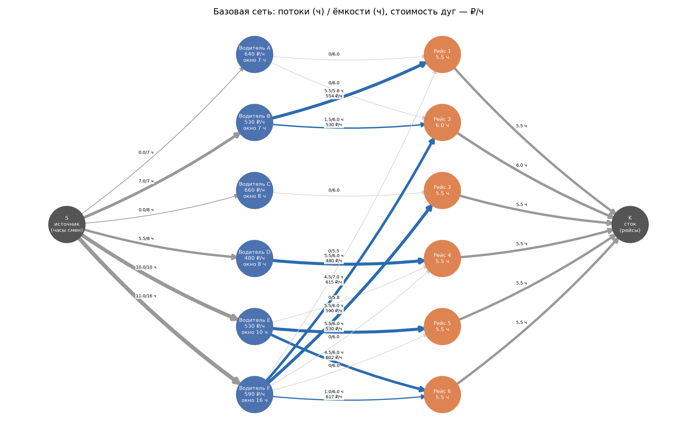
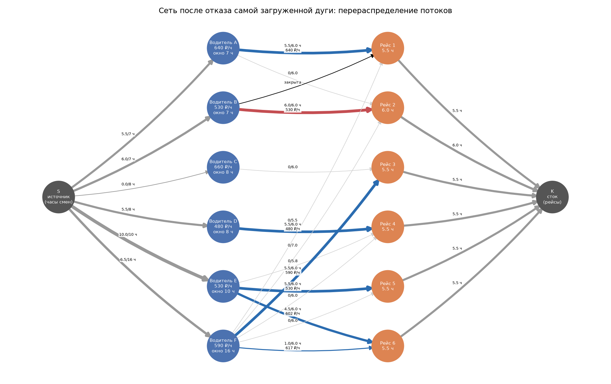
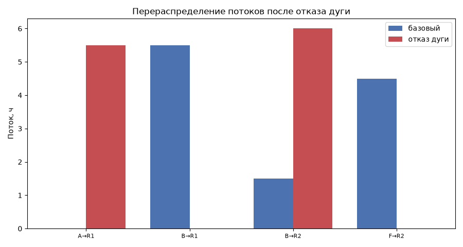
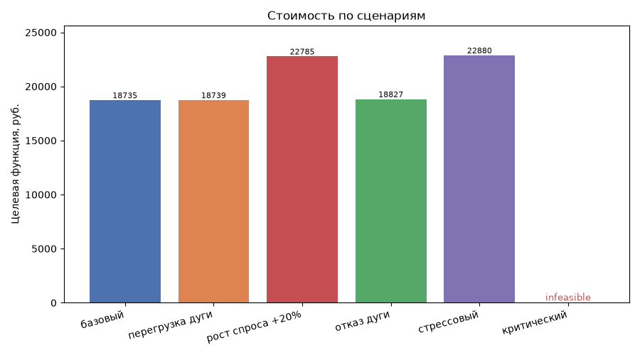
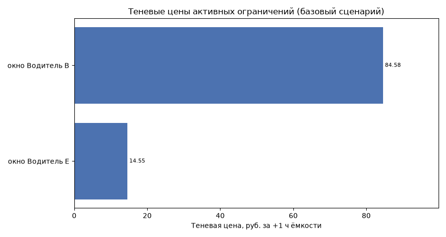
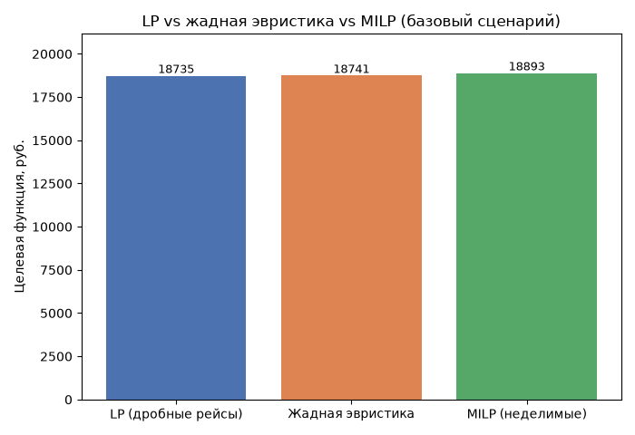

# Отчёт по лабораторной работе № 2. Транспортные и сетевые модели

## 1. Постановка задачи и индивидуальный вариант

Число варианта: V = 7; студент N = 18; группа Q = 2; год Y = 26; seed = 10218.

Задача варианта 7: назначение водителей на рейсы с окнами времени (6 водителей, 6 рейсов). Требуется минимизировать совокупные эксплуатационные затраты, распределив часы работы водителей по рейсам так, чтобы каждый рейс был полностью покрыт, мощность каждого водителя (длина окна) не была превышена, а назначение было допустимо по пересечению окон времени с учётом подачи транспорта.

Сеть: исток S → вершины водителей → вершины рейсов → сток K; дуги S→водитель имеют ёмкость равную длине окна водителя, дуги водитель→рейс существуют только при совместимости окон и имеют ёмкость и стоимость, дуги рейс→K несут спрос рейса.

## 2. Данные варианта и процедура генерации

детерминированно из seed numpy.random.default_rng(seed): ставки водителей — равномерные 450..720 руб./ч с шагом 10; зоны, окна водителей и рейсов, длительности рейсов — из фиксированных шаблонов варианта; подача travel = 0.25 ч на зону; дуга (водитель, рейс) существует, если перекрытие доступного окна после подачи не меньше длительности рейса; ёмкость дуги = min(длина окна водителя, перекрытие); стоимость дуги = ставка × (1 + подача / длительность).

| Водитель | Зона | Окно, ч | Мощность, ч | Ставка, ₽/ч |
| --- | --- | --- | --- | --- |
| Водитель A | 0 | 06:00–13:00 | 7 | 640 |
| Водитель B | 1 | 06:00–13:00 | 7 | 530 |
| Водитель C | 2 | 08:00–16:00 | 8 | 660 |
| Водитель D | 3 | 10:00–18:00 | 8 | 480 |
| Водитель E | 4 | 12:00–22:00 | 10 | 530 |
| Водитель F | 2 | 06:00–22:00 | 16 | 590 |

| Рейс | Зона | Окно, ч | Спрос, ч | Допустимых водителей |
| --- | --- | --- | --- | --- |
| Рейс 1 | 0 | 06:00–12:00 | 5.5 | 3 |
| Рейс 2 | 1 | 07:00–14:00 | 6.0 | 3 |
| Рейс 3 | 2 | 09:00–15:00 | 5.5 | 2 |
| Рейс 4 | 3 | 12:00–18:00 | 5.5 | 3 |
| Рейс 5 | 4 | 14:00–20:00 | 5.5 | 2 |
| Рейс 6 | 1 | 16:00–22:00 | 5.5 | 2 |

Всего допустимых дуг: 15 из 36 возможных пар (совместимость окон отсекает несовместимые назначения). Суммарная мощность водителей: 56 ч; суммарный спрос: 33.5 ч (отношение 1.67).

| Параметр | Единица измерения |
| --- | --- |
| H_i — мощность водителя (длина окна) | ч |
| h_j — спрос рейса (длительность) | ч |
| u_ij — ёмкость дуги (пересечение окон с учётом подачи) | ч |
| t_ij — подача (время переезда в зону рейса) | ч |
| c_ij — стоимость часа работы водителя i на рейсе j | руб./ч |
| rate_i — почасовая ставка водителя | руб./ч |
| x_ij — поток по дуге (часы на рейсе) | ч |
| Целевая функция | руб. |

## 3. Формальная модель

Множества: водители D = {Водитель A, Водитель B, Водитель C, Водитель D, Водитель E, Водитель F}; рейсы T = {Рейс 1, Рейс 2, Рейс 3, Рейс 4, Рейс 5, Рейс 6}; допустимые дуги A ⊆ D × T (|A| = 15).

Переменные: x_ij ≥ 0 — часы работы водителя i на рейсе j, ч (непрерывная переменная потока).

Параметры: H_i — мощность окна водителя, ч; h_j — длительность рейса, ч; u_ij — ёмкость дуги, ч; c_ij = rate_i · (1 + t_ij / h_j) — стоимость часа потока, руб./ч.

min Σ_(i,j)∈A c_ij · x_ij

- Баланс рейса (спрос): для каждого рейса j ∈ T суммарный поток равен длительности: Σ_i x_ij = h_j.

- Мощность водителя: для каждого водителя i ∈ D суммарные часы не превышают окно: Σ_j x_ij ≤ H_i.

- Границы дуг: 0 ≤ x_ij ≤ u_ij (работа в пределах совместимого пересечения окон).

- Неотрицательность: x_ij ≥ 0.

Ограничения баланса — типичные узловые условия потока; вместе с источником S (дуги S→i с ёмкостью H_i) и стоком K (дуги j→K с потоком h_j) модель является задачей о минимальной стоимости потока в сети.

## 4. Двойственная задача и интерпретация

Двойственная задача: max Σ_j β_j·h_j − Σ_i α_i·H_i − Σ_(i,j) γ_ij·u_ij при ограничениях β_j − α_i − γ_ij ≤ c_ij для всех дуг (i,j) ∈ A, α ≥ 0, γ ≥ 0, β свободны по знаку.

Смысл: β_j — потенциал рейса j, предельная (предельно допустимая) стоимость часа спроса рейса; α_i — дефицит (теневая цена) часа окна водителя i, на сколько снизились бы затраты при +1 ч мощности; γ_ij — ценность ёмкости дуги. Для несвязанных (нулевых) потоков выполняется сокращённая стоимость rc_ij = c_ij − β_j + α_i + γ_ij ≥ 0.

Численная проверка: primal = 18735.140000 руб., dual = 18735.140000 руб., |primal − dual| = 3.64e-12; максимальное нарушение дополняющей двойственности 0.00e+00, нарушений rc < 0: 0.00e+00.

Дуги с ненулевым потоком (8) имеют rc = 0 (в пределах точности); дуги без потока (7) имеют rc ≥ 0 — их использование неоптимально.

| Потенциал рейса β_j | Значение, ₽/ч |
| --- | --- |
| Рейс 1 | 638.67 |
| Рейс 2 | 614.58 |
| Рейс 3 | 590.00 |
| Рейс 4 | 480.00 |
| Рейс 5 | 544.55 |
| Рейс 6 | 616.82 |

Потенциалы показывают предельную стоимость обслуживания каждого рейса: самый дорогой — Рейс 1 (638.7 ₽/ч), самый дешёвый — Рейс 4 (480.0 ₽/ч).

## 5. Допущения и учебные упрощения

1) ЛП допускает дробное разделение рейса между водителями (x_ij — часы); на практике рейс неделим, что проверяется в дополнительном задании (MILP). 2) Затраты линейны: стоимость часа потока c_ij включает ставку водителя и подачу, отнесённую на часы рейса; подача при дроблении делится пропорционально часам. 3) Окна времени жёсткие: дуга существует только если водитель успевает выполнить рейс целиком (пересечение доступного окна после подачи ≥ длительность рейса). 4) Модель не учитывает точный график внутри дня при нескольких рейсах одного водителя: ограничение — сумма часов ≤ длина окна; последовательность и отсутствие наложений предполагаются согласованными диспетчером. 5) Нет неопределённости спроса, задержек и простоев; затраты детерминированы.

## 6. Реализация

Модель собирается из матриц A_eq/A_ub и решается SciPy `linprog` с методом HiGHS (`method='highs-ds'`, dual simplex), options: presolve=True, disp=False. Версии: Python 3.14.3, SciPy 1.18.0, NetworkX 3.7; HiGHS поставляется в составе SciPy, версии зафиксированы в requirements.txt.

Интерфейс: `build_model(Instance) → LPModel(c, A_ub, b_ub, A_eq, b_eq, bounds, constraint_labels, equality_labels, arc_capacity_rows, driver_rows)`; переменные индексируются дугами сети.

Базовый сценарий: статус optimal, целевая функция 18735.14 руб., итераций 4, время решения 4.29 мс.

## 7. Статус решения и интерпретация

Статус: optimal. Целевая функция: 18735.14 руб.

Статус `optimal` означает найденное допустимое решение, минимизирующее затраты: все узловые балансы и границы дуг выполнены с допуском 1e-7. Статус `infeasible` означает несовместимость ограничений (спрос не покрывается мощностью и совместимыми окнами) и требует диагностики — она выполнена в критическом сценарии. Статус `unbounded` для этой модели невозможен: целевая функция ограничена снизу нулёми, а сверху — конечной мощностью сети.

## 8. Независимая проверка

| check | ok | violation |
| --- | --- | --- |
| границы дуг: все x >= 0 | True | 0.000e+00 |
| границы дуг: x <= ёмкость дуги | True | 0.000e+00 |
| баланс вершин-водителей: приток от источника = сумма потоков по рейсам <= мощность окна | True | 0.000e+00 |
| баланс вершин-рейсов: приток = спрос, отток в сток = спрос | True | 0.000e+00 |
| баланс источника и стока: отток источника = приток стока | True | 0.000e+00 |
| целевая функция пересчитана из x | True | 0.000e+00 |

Objective из солвера: 18735.14; пересчитан из x средствами NumPy: 18735.14; разница: 0.000e+00. Проверки выполняются отдельным кодом без обращения к объекту солвера: баланс каждой вершины (водитель: приток от источника = сумма потоков и ≤ мощности; рейс: приток = отток = спрос; исток и сток: отток = приток), границы каждой дуги (0 ≤ x ≤ u) и пересчёт цели.

| Водитель | Загрузка, ч | Мощность, ч | Запас, ч | Ограничение активно |
| --- | --- | --- | --- | --- |
| Водитель A | 0.00 | 7.0 | 7.00 | нет |
| Водитель B | 7.00 | 7.0 | 0.00 | да |
| Водитель C | 0.00 | 8.0 | 8.00 | нет |
| Водитель D | 5.50 | 8.0 | 2.50 | нет |
| Водитель E | 10.00 | 10.0 | 0.00 | да |
| Водитель F | 11.00 | 16.0 | 5.00 | нет |

## 9. Схема сети и найденные потоки

На схеме: толщина дуги пропорциональна потоку, красным отмечены насыщенные дуги (поток = ёмкость), серым — допустимые дуги без потока; подписи — поток/ёмкость в часах, на дугах водитель→рейс также указана стоимость, ₽/ч.

| Дуга | Поток, ч | Ёмкость, ч | Загрузка | ₽/ч | Затраты, ₽ |
| --- | --- | --- | --- | --- | --- |
| Водитель A → Рейс 1 | 0.00 | 6.00 | 0% | 640.0 | 0.00 |
| Водитель A → Рейс 2 | 0.00 | 6.00 | 0% | 666.7 | 0.00 |
| Водитель B → Рейс 1 | 5.50 | 5.75 | 96% | 554.1 | 3047.50 |
| Водитель B → Рейс 2 | 1.50 | 6.00 | 25% | 530.0 | 795.00 |
| Водитель C → Рейс 3 | 0.00 | 6.00 | 0% | 660.0 | 0.00 |
| Водитель D → Рейс 4 | 5.50 | 6.00 | 92% | 480.0 | 2640.00 |
| Водитель E → Рейс 4 | 0.00 | 5.75 | 0% | 554.1 | 0.00 |
| Водитель E → Рейс 5 | 5.50 | 6.00 | 92% | 530.0 | 2915.00 |
| Водитель E → Рейс 6 | 4.50 | 6.00 | 75% | 602.3 | 2710.22 |
| Водитель F → Рейс 1 | 0.00 | 5.50 | 0% | 643.6 | 0.00 |
| Водитель F → Рейс 2 | 4.50 | 7.00 | 64% | 614.6 | 2765.61 |
| Водитель F → Рейс 3 | 5.50 | 6.00 | 92% | 590.0 | 3245.00 |
| Водитель F → Рейс 4 | 0.00 | 6.00 | 0% | 616.8 | 0.00 |
| Водитель F → Рейс 5 | 0.00 | 6.00 | 0% | 643.6 | 0.00 |
| Водитель F → Рейс 6 | 1.00 | 6.00 | 17% | 616.8 | 616.82 |

## 10. Сценарный анализ

| Сценарий | Статус | Цель, ₽ | Δ | Δ% | Проверка |
| --- | --- | --- | --- | --- | --- |
| базовый | optimal | 18735.14 | +0.00 | +0.00% | True |
| перегрузка дуги | optimal | 18738.63 | +3.49 | +0.02% | True |
| рост спроса +20% | optimal | 22785.45 | +4050.31 | +21.62% | True |
| отказ дуги | optimal | 18827.03 | +91.90 | +0.49% | True |
| стрессовый | optimal | 22879.86 | +4144.72 | +22.12% | True |
| критический | infeasible | — | — | — | False |

- **базовый**: Базовый сценарий: данные варианта при фиксированном seed.

- **перегрузка дуги**: Перегрузка дуги: ёмкость самой загруженной дуги Водитель B→Рейс 1 снижена на 50% (со 5.8 до 2.9 ч).

- **рост спроса +20%**: Рост спроса: длительность каждого рейса увеличена на 20% (Σ 33.5 → 40.2 ч).

- **отказ дуги**: Отказ дуги: закрыта самая загруженная дуга Водитель B→Рейс 1 (поток 5.5 ч).

- **стрессовый**: Стрессовый: отказ самой загруженной дуги одновременно с ростом спроса на 20%.

- **критический**: Критический: спрос +50% и закрыты две самые загруженные дуги (ожидается несовместимость ограничений).

Перегрузка дуги (ёмкость снижена на 50%): ΔC = +3.49 руб. Ущерб мал, поскольку лимитирующим ресурсом в базовом решении было окно водителя, а не ёмкость дуги: поток перераспределяется по другим дугам совместимых водителей, и запас ёмкости поглощает сокращение.

Рост спроса на 20%: ΔC = +4050.31 руб. (+21.62%). Прогноз по базовым потенциалам: βᵀΔh = +3894.54 руб. Двойственная точка базового решения остаётся допустимой при изменении правых частей, поэтому прогноз — гарантированная нижняя граница роста затрат; факт (+4050.31) превышает её, что означает смену активного множества (подключились ранее неиспользуемые дуги и водители).

В дефицитном сценарии дополнительно насыщаются дуги: Водитель B→Рейс 1, Водитель D→Рейс 4, Водитель E→Рейс 5, Водитель F→Рейс 3 — новые узкие места сети.

Отказ дуги (самая загруженная дуга Водитель B→Рейс 1): ΔC = +91.90 руб. (+0.49%) — прямой ущерб от потери самого загруженного назначения; рейс обслуживается альтернативным водителем с более высокой стоимостью. Теневая цена ёмкости закрытой дуги в базовом решении равна нулю (запас по ёмкости), поэтому локальный прогноз не улавливает ущерб: отказ дуги — грубое изменение структуры сети, выходящее из области действия теневой цены.

Стрессовый сценарий (отказ дуги + спрос +20%): ΔC = +4144.72 руб. Ограничения накладываются: отказ сужает структуру сети, рост спроса увеличивает требования — совокупный эффект чуть больше суммы отдельных эффектов.

Критический сценарий (спрос +50% и закрыты две самые загруженные дуги): статус infeasible. Диагностика несовместимости:

- условие Холла нарушено для подмножества {Рейс 1, Рейс 4, Рейс 5, Рейс 6}: требуется 33.0 ч, доступно не более 32.0 ч с учётом мощности водителей и закрытых дуг

- условие Холла нарушено для подмножества {Рейс 1, Рейс 2, Рейс 4, Рейс 5, Рейс 6}: требуется 42.0 ч, доступно не более 39.0 ч с учётом мощности водителей и закрытых дуг

- условие Холла нарушено для подмножества {Рейс 3, Рейс 4, Рейс 5, Рейс 6}: требуется 33.0 ч, доступно не более 32.0 ч с учётом мощности водителей и закрытых дуг

- условие Холла нарушено для подмножества {Рейс 1, Рейс 3, Рейс 4, Рейс 5, Рейс 6}: требуется 41.2 ч, доступно не более 38.0 ч с учётом мощности водителей и закрытых дуг

- условие Холла нарушено для подмножества {Рейс 1, Рейс 2, Рейс 3, Рейс 4, Рейс 5, Рейс 6}: требуется 50.2 ч, доступно не более 45.0 ч с учётом мощности водителей и закрытых дуг

Вывод: ограничения конфликтуют не только по суммарной мощности, но и локально — закрытые дуги и окна времени оставляют часть рейсов без допустимых исполнителей; при infeasible солвер не даёт плана, а диагностика указывает конкретные конфликтующие подмножества.

## 11. Узкие места сети и теневые цены

| Ограничение | rhs, ч | Теневая цена, ₽/ч | Запас, ч |
| --- | --- | --- | --- |
| мощность[Водитель B] | 7.00 | 84.58 | 0.000 |
| мощность[Водитель E] | 10.00 | 14.55 | 0.000 |

Главное узкое место базового сценария: мощность[Водитель B] — +1 ч мощности снизил бы затраты на 84.58 руб./ч. Ненулевые теневые цены имеют только активные ограничения; остальные запасы избыточны.

В базовом решении нет дуг с потоком, равным ёмкости: лимитирующими оказываются окна водителей, а пересечения окон дают небольшой запас. Наиболее загруженные дуги: Водитель B→Рейс 1 (5.5/5.8 ч, 96%), Водитель D→Рейс 4 (5.5/6.0 ч, 92%), Водитель E→Рейс 5 (5.5/6.0 ч, 92%).

Связь с теневыми ценами: дуги с запасом ёмкости имеют γ_ij = 0, поэтому их локальное расширение бесполезно; ресурс, за который стоит бороться, — часы окон активных водителей (α_i > 0). В дефицитном сценарии (см. раздел 10) насыщаются и дуги — их γ становится положительным.

## 12. Сравнение с жадной эвристикой

| Сценарий | LP статус | LP, ₽ | Жадный, ₽ | Зазор | Не покрыто жадным, ч |
| --- | --- | --- | --- | --- | --- |
| базовый | optimal | 18735.14 | 18741.12 | 0.032% | 0.00 |
| перегрузка дуги | optimal | 18738.63 | 18741.12 | 0.013% | 0.00 |
| рост спроса +20% | optimal | 22785.45 | 22791.77 | 0.028% | 0.00 |
| отказ дуги | optimal | 18827.03 | 18827.03 | 0.000% | 0.00 |
| стрессовый | optimal | 22879.86 | 22879.86 | 0.000% | 0.00 |
| критический | infeasible | — | — | — | — |

Жадная эвристика («сначала самые дешёвые дуги»: сортировка по c_ij, налив потока min(остаток мощности, остаток спроса, ёмкость)) даёт стоимость 18741.12 руб. против оптимума 18735.14 руб.: зазор 0.032%. Эвристика полностью покрывает спрос, но жадный порядок не учитывает дефицит дешёвой мощности на будущие (более дорогие) рейсы, поэтому уступает оптимуму.

## 13. Содержательный вывод

Оптимальные суммарные затраты базового сценария: 18735.14 руб. (6 рейсов, 33.5 ч работы).

| Рейс | Спрос, ч | Назначение |
| --- | --- | --- |
| Рейс 1 | 5.5 | Водитель B: 5.5 ч |
| Рейс 2 | 6.0 | Водитель B: 1.5 ч; Водитель F: 4.5 ч |
| Рейс 3 | 5.5 | Водитель F: 5.5 ч |
| Рейс 4 | 5.5 | Водитель D: 5.5 ч |
| Рейс 5 | 5.5 | Водитель E: 5.5 ч |
| Рейс 6 | 5.5 | Водитель E: 4.5 ч; Водитель F: 1.0 ч |

Задействованы: Водитель B (7.0/7 ч); Водитель D (5.5/8 ч); Водитель E (10.0/10 ч); Водитель F (11.0/16 ч).

Не задействованы: Водитель A; Водитель C. Причины предметные: окна не совпадают с окнами рейсов и/или ставка выше, чем у альтернатив — модель выбирает дешёвую совместимую мощность.

Дефицитные и стрессовые сценарии показывают: сеть устойчива к одиночному отказу дуги (перераспределение за счёт запаса окон), но рост спроса на 20% резко поднимает затраты, так как дешёвая мощность уже исчерпана; критическое сочетание делает задачу несовместимой.

## 14. Можно ли реализовать найденное решение на практике

Решение реализуемо как ориентир диспетчеризации, но ограничено моделью: 1) дробные назначения (часть рейса двум водителям) на практике недопустимы — требуется MILP (см. раздел 15); 2) не моделируются последовательность и пересечения окон при нескольких рейсах одного водителя в течение дня, а также время на перерывы и возврат в депо; 3) затраты линейны — нет сверхурочных, ночных тарифов, штрафов за опоздание; 4) спрос и время в пути детерминированы: задержки, пробки и отказы техники не учтены; 5) окна времени и подача заданы точно, на практике они оценочны. Для внедрения нужна проверка последовательности рейсов, целочисленный план и буфер времени.

## 15. Дополнительное задание: LP против MILP (неделимые рейсы)

LP (дробные рейсы): 18735.14 руб., время 7.90 мс; MILP (каждый рейс целиком одному водителю, бинарные y_ij, HiGHS branch-and-bound): 18892.51 руб., статус optimal, зазор 0.0, узлов 1, время 8.29 мс.

Зазор неделимости: 157.37 руб. (0.84%). LP разделяет рейсы между водителями: Рейс 2, Рейс 6

Вывод: LP-релаксация допускает разделение рейсов и поэтому недооценивает затраты; MILP даёт реализуемый последовательный план с небольшим (доли процента) удорожанием; время решения обоих методов сопоставимо и измеряется миллисекундами на масштабе 6×6.

## 16. Используемые артефакты

- `out/seed_10218/solution.csv` — таблица найденных потоков.

- `out/seed_10218/verification.txt` — результаты независимой проверки.

- `out/seed_10218/scenarios.csv` — сценарии и диагностика несовместимости.

- `out/seed_10218/shadow_prices.csv` — теневые цены активных ограничений.

- `out/seed_10218/demand_duals.csv` — потенциалы рейсов (двойственные переменные спроса).

- `out/seed_10218/greedy_comparison.csv` — сравнение с жадной эвристикой.

- `out/seed_10218/milp_comparison.csv` — сравнение LP и MILP.

- `out/seed_10218/dual_check.txt` — проверка сильной двойственности.

- `out/seed_10218/solver_log.txt` — лог HiGHS.

- `out/seed_10218/figures/*.png` — графики и схемы сети.

- `report/seed_10218/REPORT.pdf` — отчёт варианта.

